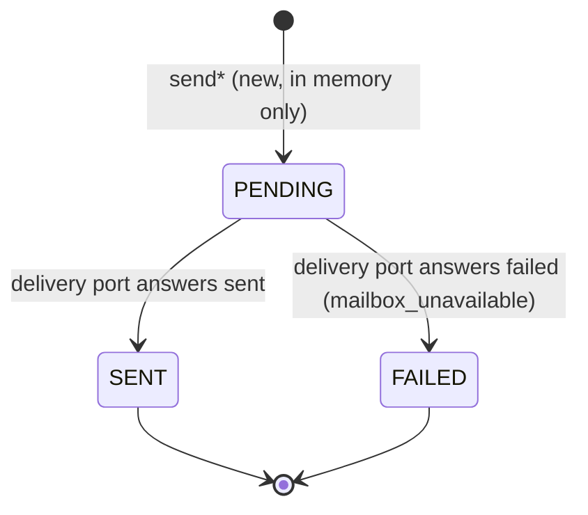
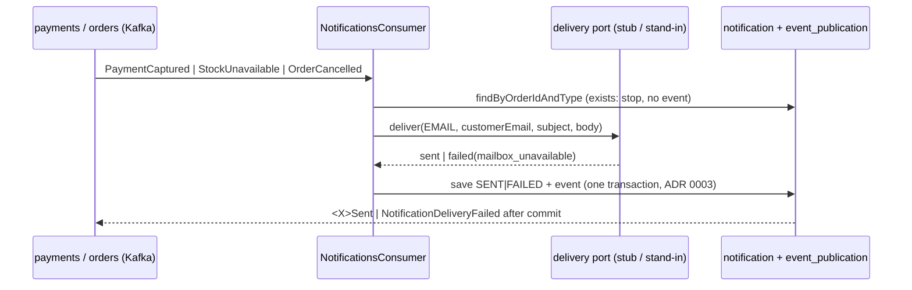

# place-order-flow: projections review (gate item 5)

Date: 2026-11-26. Reviewed by claude on behalf of the person. Projections of `notifications-consumer-api` service-all
0.2.0 ([SUMMARY.md](../../../notifications-consumer-api/SUMMARY.md),
[EVENT_CATALOG.md](../../../notifications-consumer-api/EVENT_CATALOG.md),
[asyncapi.yml](../../../notifications-consumer-api/asyncapi.yml),
[asyncapi-client.yml](../../../notifications-consumer-api/asyncapi-client.yml),
[openapi.yml](../../../notifications-consumer-api/openapi.yml), `avro/*.avsc`) against the ZDL and the ZFL.

## State machine (Notification, zdl:54-71, 118-128)

Agrees with the ZDL (`initial: PENDING`, `to: [SENT, FAILED]`, no `from`) and the ZFL redelivery rule (a redelivered
event on SENT or FAILED is a no-op, no event). SUMMARY.md has no diagram: it states the scope only. As designed.

## Sequence per branch (this context)

| Branch (ZFL) | Consumed (channel) | Command | Published (topic) | End |
|---|---|---|---|---|
| completed (zfl:207-213) | `PaymentCaptured` (`payment-captured-event-v1`, payments) | `sendOrderConfirmation` [sent] | `OrderConfirmationSent` (`notifications-consumer.order-confirmation-sent.event.avro.v1`) | `completed` |
| stockGone (zfl:228-234) | `StockUnavailable` (`stock-unavailable-event-v1`, orders) | `sendStockUnavailableNotification` [sent] | `StockUnavailableNotificationSent` (`...stock-unavailable-notification-sent.event.avro.v1`) | `stockGone` |
| orderCancelled (zfl:328-334) | `OrderCancelled` (`order-cancelled-event-v1`, orders) | `sendOrderCancelledNotification` [sent] | `OrderCancelledNotificationSent` (`...order-cancelled-notification-sent.event.avro.v1`) | `orderCancelled` |
| notificationFailed (zfl:336-345) | any of the three | any [failed] | `NotificationDeliveryFailed` (`...notification-delivery-failed.event.avro.v1`), `type` says which | `notificationFailed` |
| redelivery (zfl:67-68) | any of the three, Notification exists | any | nothing | - |

## Contracts

| # | Projection | Check | Result / decision |
|---|---|---|---|
| R-01 | asyncapi.yml | 4 channels, addresses = ZDL `@asyncapi` topics (zdl:131, 141, 152, 164), `action: send` | ✅ |
| R-02 | avro/*.avsc | fields match the ZDL events one to one; enums `NotificationType`, `NotificationChannel` match zdl:73-83 | ✅. `type` and `channel` are non-null enums, `skus` a non-null array: the mapper always sets them (`skus` empty for non-stock types, A-06). Timestamps are strings (ISO-8601). |
| R-03 | asyncapi.yml | generated binding names `on-order-confirmation-sent-out`, `on-stock-unavailable-notification-sent-out`, `on-order-cancelled-notification-sent-out`, `on-notification-delivery-failed-out` | input for T-10 (bindings in application.yml). |
| R-04 | asyncapi.yml | three messages have empty `title`/`summary`; `NotificationDeliveryFailedEvent` title shows the doc comment with HTML-escaped backticks (`&#x60;`) | cosmetic generator output; no action (models repo is read-only, nothing depends on it). |
| R-05 | asyncapi.yml | `defaultContentType: application/json` while every payload is Avro (`schemaFormat` per message) | cosmetic; the per-message `schemaFormat` wins. No action. |
| R-06 | asyncapi-client.yml | 3 `receive` operations = ZDL `@asyncapi(api, channel)` (zdl:118, 122, 126); `$ref` to producers' `main`; retry topics 3 (5s/30s/5m) + DLQ | ✅. Consumer beans `payment-captured-event-v1`, `stock-unavailable-event-v1`, `order-cancelled-event-v1` (T-10 function definition). `main` coupling accepted (overlay, grill G-15). |
| R-07 | consumed payloads | `PaymentCaptured`, `StockUnavailable`, `OrderCancelled` carry `orderId`, `customerId`, `customerEmail` (+ `unavailableItems`, `reason`) = every required input field (zdl:91-113) | ✅ (grill G-03). |
| R-08 | openapi.yml | `paths: {}`, `schemas: {}` | ✅ as designed: no REST API. |
| R-09 | SUMMARY.md | scope = the three notifications + delivery tracking; "decides ... through which channel" | ✅; the channel rule is "always EMAIL" (ADR 0002), SMS / PUSH unused. |
| R-10 | EVENT_CATALOG.md | business prose; success and failure as distinct outcomes; no vendor | ✅ agrees with the stand-in sender (ADR 0002). |

No ❌, no proposal.
